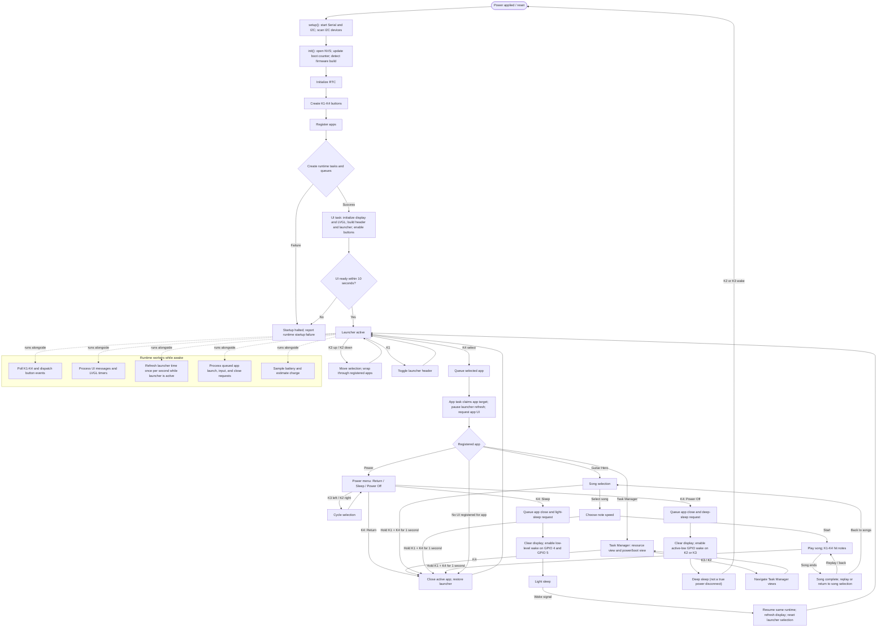

# Micro-Deck project state flow

This flow chart follows the current firmware implementation in `src/`. It covers
startup, the launcher, registered apps, and both sleep paths.

## Current implementation notes

- `setupApps()` registers **Power**, **Task Manager**, and **Guitar Hero** as
  launcher entries. `APP_ID_MUSIC_PLAY` is defined in the build configuration,
  but it is not currently registered by `setupApps()`.
- The Power menu's **Power Off** action calls `esp_deep_sleep_start()`. The
  processor remains in deep sleep and can wake on K2/K3; this is not equivalent
  to physically disconnecting power. A physically unpowered device must have
  power restored before it can boot.
- Light sleep is a suspend/resume path in the current runtime. Its configured
  wake sources are `GPIO_NUM_4` and `GPIO_NUM_5`; after waking, the firmware
  refreshes the UI and resets launcher navigation.
- Deep-sleep wake restarts `setup()` and follows the normal initialization path;
  app execution is not restored. The wake-derived boolean passed to `init()` is
  currently unused by `init()`.
